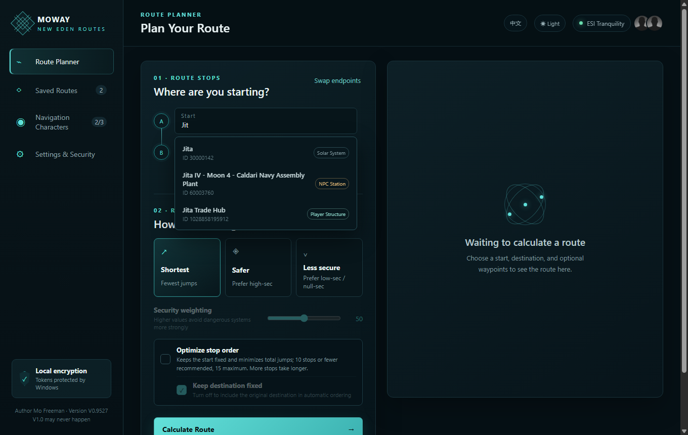
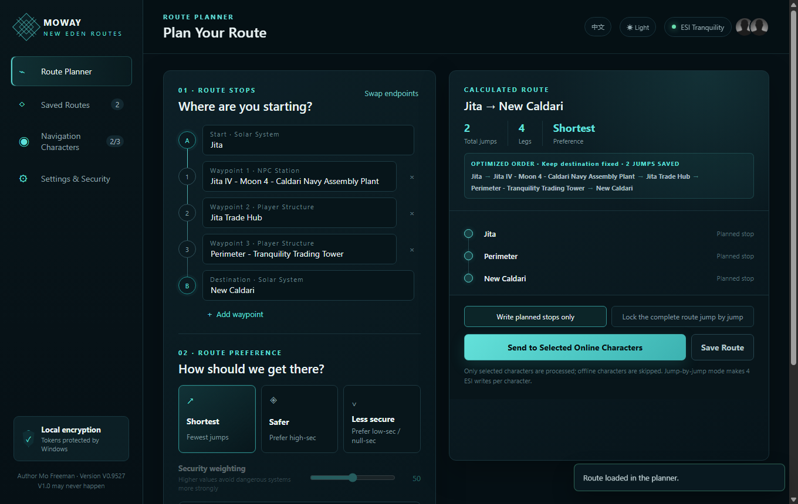
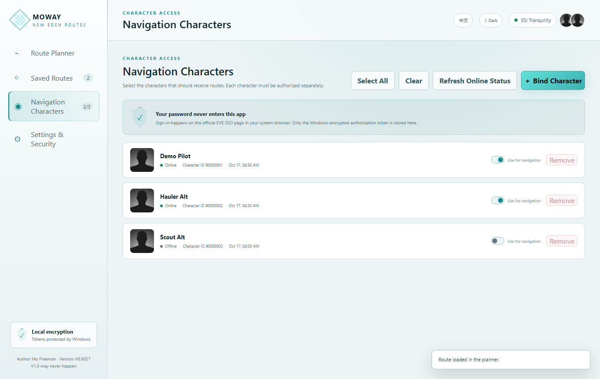
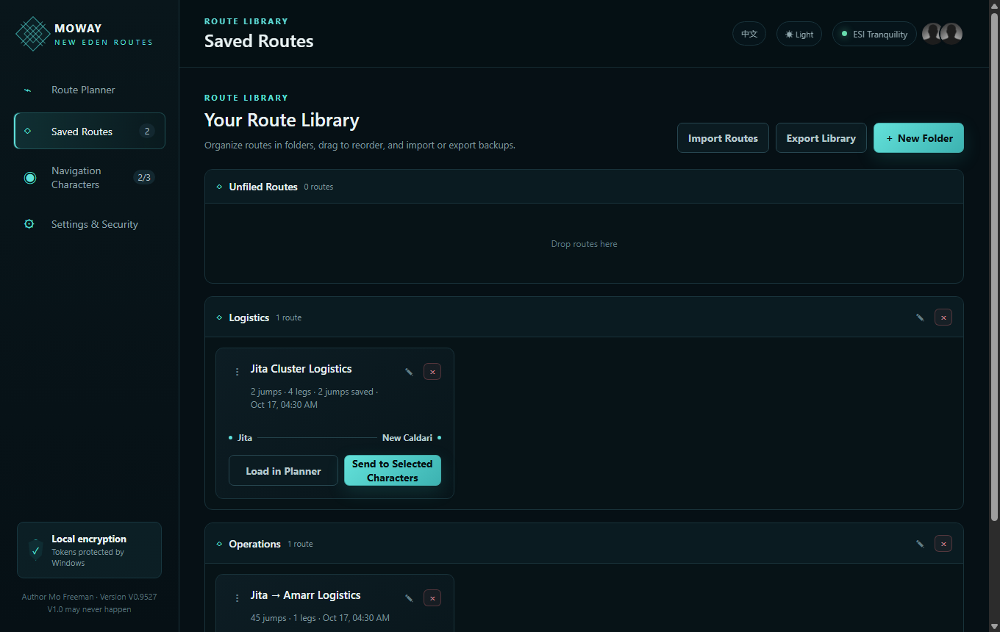
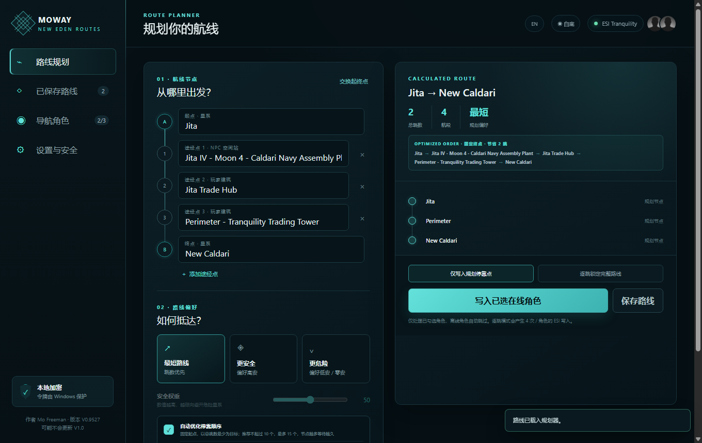
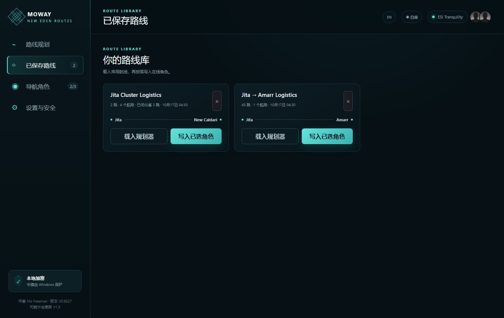

# MOWAY V0.9527

[English](#english) | [简体中文](#简体中文)

<a id="english"></a>

## English

**A Windows route planner and waypoint manager for EVE Online.**

MOWAY plans and optimizes multi-stop routes outside the game, saves frequently used routes,
and sends them to multiple selected online characters through EVE ESI.

Its defining feature is **batch waypoint delivery at exact station or player-structure level**.
If several destinations are located in the same solar system, MOWAY keeps every station or
structure as a separate waypoint instead of collapsing them into one system-level destination.

> This program was written entirely by AI and has not received an independent professional
> security audit. Its security is uncertain. Use it at your own risk.

### Features

- Plan multi-stop EVE routes outside the game
- Search solar systems, NPC stations, and character-visible player structures
- Preserve exact station and player-structure destination IDs
- Optimize stop order for the lowest total stargate jump count
- Keep the starting point fixed
- Optionally keep the final destination fixed
- Support up to 15 stops during exact automatic optimization
- Send one route to multiple selected online characters
- Skip offline characters without interrupting the others
- Save, load, and delete frequently used routes
- Choose between planned-stop and jump-by-jump waypoint modes
- Switch between dark and light themes
- Switch between Chinese and English UI
- Keep all EVE character and location names in their original ESI form

### Screenshots

The screenshots below use demonstration data only and contain no real character or account information.

#### Exact location autocomplete



#### Exact route optimization and batch waypoint delivery



#### Multi-character selection



#### Saved routes



### Downloads

#### Fast folder version — recommended

Download `MOWAY-V0.9527-fast-folder.zip`, extract the complete folder, and run `MOWAY.exe`.

Do not move only `MOWAY.exe` out of the extracted folder. It requires the DLL files, locale
files, and `resources` folder beside it.

#### Single-file portable version

Download `MOWAY-V0.9527-route-optimizer-portable.exe` and run it directly.

The portable version normally starts more slowly because it must extract temporary files
each time it is launched.

### System Requirements

- 64-bit Windows 10 or Windows 11
- Internet access to EVE SSO and ESI
- An EVE Online account
- An EVE Developer application Client ID

### EVE SSO Setup

Create an **Authentication & API Access** application at:

https://developers.eveonline.com/applications

Use this callback URL exactly:

```text
http://127.0.0.1:17890/callback
```

Add these four scopes:

```text
esi-location.read_online.v1
esi-ui.write_waypoint.v1
esi-search.search_structures.v1
esi-universe.read_structures.v1
```

Save the application and paste its public Client ID into **Settings & Security** in MOWAY.

MOWAY uses Authorization Code with PKCE. A desktop PKCE application does not need a Client
Secret, so never enter or share one.

Every user must authorize their own characters through the official EVE SSO page. MOWAY has
no password field and never reads the user's EVE password.

### Basic Usage

1. Configure the EVE application Client ID.
2. Bind each character through official EVE SSO.
3. Select the characters that should receive navigation routes.
4. Enter at least three characters to search for a location.
5. Choose solar systems, NPC stations, or accessible player structures.
6. Add any required intermediate stops.
7. Select a route preference.
8. Optionally enable automatic stop-order optimization.
9. Calculate and review the route.
10. Send it to the selected online characters.

### Route Optimization

Automatic optimization keeps the start fixed and rearranges the remaining stops to minimize
the total number of stargate jumps. The destination can optionally remain fixed.

Ten or fewer stops are recommended. Exact optimization supports up to 15 stops. Routes near
the limit may require many ESI requests and take longer to calculate.

Different stations or player structures in the same system remain separate exact waypoints.
Travel between them costs zero stargate jumps, so MOWAY optimizes inter-system jump order but
does not claim to determine the best in-system order by warp distance.

Optimization does not understand live gate camps, bubbles, wars, hostile groups, or other
tactical conditions. Always review the route before sending it to characters.

### Waypoint Modes

#### Write planned stops only

Writes only the selected systems, stations, structures, and intermediate stops. This mode
uses fewer ESI requests.

#### Lock the complete route jump by jump

Writes every calculated jump in order. This makes more ESI requests, so long routes and
multiple characters require more time.

Writing a new route clears the character's existing autopilot waypoints.

### Language Support

Use the **EN / 中文** button in the upper-right corner to switch the interface language.
The choice is saved locally.

Only MOWAY interface text is translated. Solar systems, NPC stations, player structures,
character names, and other data received from ESI remain unchanged.

### Local Data and Security

MOWAY stores its local data under:

```text
%APPDATA%\moway
```

The main data file is:

```text
%APPDATA%\moway\navigator-data.json
```

Refresh tokens are encrypted through Electron `safeStorage` and Windows protection. Access
tokens remain in process memory. MOWAY does not include an author server, advertising,
analytics, telemetry, or cloud synchronization.

Do not share:

- Client Secret
- `navigator-data.json`
- The `%APPDATA%\moway` folder
- Access tokens or refresh tokens
- A copy of personal application data containing bound characters
- Configuration files containing a private email address or Discord contact

The current EXE does not have a commercial code-signing certificate. Windows SmartScreen
may therefore display an **Unknown publisher** warning. Obtain MOWAY from a trusted source
and verify its SHA-256 hash.

Read the included Chinese or English safety notice before using MOWAY.

### SHA-256

```text
AF5F01056ADA8939797679ADDFCEE2631F0121571E40D49BA5DFAAC5CE0DED97
MOWAY-V0.9527-fast-folder.zip

51307BBD08E25105F77A04B83791BD7D3B00FFB01DA7943B37DD3D2B1375CB0B
MOWAY-V0.9527-route-optimizer-portable.exe
```

### Disclaimer

MOWAY is not affiliated with or endorsed by CCP Games.

EVE Online, ESI, and related names and trademarks belong to CCP hf.

**Author:** Mo Freeman  
**Version:** V0.9527  
**V1.0 may never happen.**

<a id="简体中文"></a>

## 简体中文

MOWAY 是一款面向 Windows 的 EVE Online 第三方路线规划工具。

MOWAY 可以在游戏外规划并优化多段路线、保存常用路线，并通过 EVE ESI 将路线批量
写入多个已选择且当前在线的角色。

它最主要的特色是**批量写入精确到 NPC 空间站或玩家建筑级别的路径点**。即使多个
目的地位于同一星系，MOWAY 也不会把它们合并成一个星系路径点，而会把每个空间站
或建筑保留为独立目的地。

> 本程序全部由 AI 编写，未经过独立专业安全审计，不确定安全性，使用请自行承担风险。

### 功能

- 在游戏外规划多段 EVE 路线
- 联想搜索太阳系、NPC 空间站和角色可见的玩家建筑
- 保留实际空间站和玩家建筑的精确目的地 ID
- 以总星门跳数最少为目标优化停靠顺序
- 固定起点
- 可选择是否固定终点
- 精确自动优化最多支持 15 个节点
- 将同一条路线批量写入多个已选择且在线的角色
- 自动跳过离线角色，不影响其他角色继续处理
- 保存、载入和删除常用路线
- 支持“仅写入规划停靠点”和“逐跳锁定完整路线”两种模式
- 支持深色和白底主题
- 支持中文与英文 UI 切换
- EVE 角色和地点名称始终保留 ESI 返回的原文

### 界面截图

以下截图仅使用演示数据，不包含任何真实角色或账号信息。

#### 精确地点联想


#### 精确路线优化与批量写入



#### 多角色选择


#### 已保存路线



### 下载

#### 快速文件夹版——推荐

下载 `MOWAY-V0.9527-fast-folder.zip`，完整解压后运行 `MOWAY.exe`。

不要只把 `MOWAY.exe` 移出解压后的文件夹。程序还需要同目录内的 DLL、语言文件和
`resources` 文件夹。

#### 单文件便携版

下载并直接运行 `MOWAY-V0.9527-route-optimizer-portable.exe`。

单文件版每次启动时都需要临时解压文件，因此通常比文件夹版启动得慢。

### 系统要求

- 64 位 Windows 10 或 Windows 11
- 能够访问 EVE SSO 和 ESI
- EVE Online 账号
- EVE Developer 应用的 Client ID

### 配置 EVE SSO

在以下页面创建 **Authentication & API Access** 应用：

https://developers.eveonline.com/applications

回调地址必须逐字填写：

```text
http://127.0.0.1:17890/callback
```

添加以下四项权限：

```text
esi-location.read_online.v1
esi-ui.write_waypoint.v1
esi-search.search_structures.v1
esi-universe.read_structures.v1
```

保存应用，然后把公开的 Client ID 粘贴到 MOWAY 的“设置与安全”页面。

MOWAY 使用 Authorization Code + PKCE。桌面 PKCE 应用不需要 Client Secret，
因此不要填写或分享 Client Secret。

每位用户都必须在 EVE 官方 SSO 页面为自己的角色进行授权。MOWAY 没有密码输入框，
不会读取用户的 EVE 密码。

### 基本用法

1. 配置 EVE 应用 Client ID。
2. 通过 EVE 官方 SSO 分别绑定每个角色。
3. 勾选需要接收路线的角色。
4. 输入至少三个字符搜索地点。
5. 选择太阳系、NPC 空间站或角色可见的玩家建筑。
6. 添加需要的途经点。
7. 选择路线偏好。
8. 按需启用自动优化停靠顺序。
9. 计算并检查路线。
10. 将路线写入已选择且在线的角色。

### 路线优化

自动优化会固定起点，并重新排列其他节点，以总星门跳数最少为目标。用户可以选择
是否同时固定终点。

推荐优化 10 个以内的节点；精确优化最多支持 15 个节点。接近上限时需要进行较多
ESI 路线请求，因此计算时间可能更长。

同一星系内的不同空间站或玩家建筑会保留为独立的精确路径点。它们之间按 0 个星门
跳跃计算，因此 MOWAY 优化的是星系之间的跳跃顺序，不会声称能够根据星系内跃迁
距离判断最佳建筑先后顺序。

路线优化无法识别实时营地、泡泡、战争、敌对势力或其他战术情况。将路线写入角色
之前，请务必自行检查。

### 路径点写入模式

#### 仅写入规划停靠点

只写入用户选择的星系、空间站、建筑和途经点，使用的 ESI 请求较少。

#### 逐跳锁定完整路线

按照计算顺序写入完整路线中的每一跳。此模式会产生更多 ESI 请求，长路线和多个
角色需要更长处理时间。

写入新路线会清除该角色原有的自动导航路径点。

### 语言支持

使用界面右上角的 **EN / 中文** 按钮切换语言，选择结果会保存在本机。

只有 MOWAY 的界面文字会被翻译。太阳系、NPC 空间站、玩家建筑、角色名称以及其他
通过 ESI 取得的数据都会保持原文。

### 本地数据与安全

MOWAY 的本地数据目录为：

```text
%APPDATA%\moway
```

主要数据文件为：

```text
%APPDATA%\moway\navigator-data.json
```

刷新令牌通过 Electron `safeStorage` 和 Windows 本机保护机制加密，访问令牌只保留
在程序内存中。MOWAY 不包含作者服务器、广告、统计、遥测或云同步。

请勿分享：

- Client Secret
- `navigator-data.json`
- `%APPDATA%\moway` 文件夹
- 访问令牌或刷新令牌
- 包含已绑定角色的个人程序数据副本
- 含有私人邮箱或 Discord 联系方式的配置文件

当前 EXE 没有商业代码签名证书，因此 Windows SmartScreen 可能显示“未知发布者”。
请从可信渠道获取 MOWAY，并核对 SHA-256。

使用前请阅读程序内附带的中文或英文安全说明。

### SHA-256

```text
AF5F01056ADA8939797679ADDFCEE2631F0121571E40D49BA5DFAAC5CE0DED97
MOWAY-V0.9527-fast-folder.zip

51307BBD08E25105F77A04B83791BD7D3B00FFB01DA7943B37DD3D2B1375CB0B
MOWAY-V0.9527-route-optimizer-portable.exe
```

### 免责声明

MOWAY 与 CCP Games 没有关联，也未获得 CCP Games 的认可或背书。

EVE Online、ESI 以及相关名称和商标归 CCP hf. 所有。


**作者：** Mo Freeman  
**版本：** V0.9527  
**可能不会更新 V1.0。**

